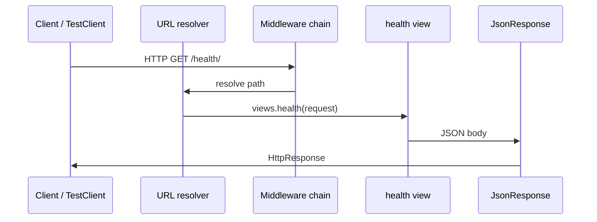

# Device Inventory API

**RU** · [EN](README.en.md) · [PL](README.pl.md)

<!-- readme-preamble -->

**Device Inventory API** — учебно-производственный репозиторий полного цикла разработки веб-сервиса на **Django**: HTTP-слой, персистентность (SQLite → PostgreSQL), **Django REST Framework**, доменная модель инвентаризации устройств, автоматизированное тестирование, контейнеризация и непрерывная интеграция. Проект логически продолжает [`hp-qa-junior-prep`](https://github.com/ANDRZEJSZAMBORSKI/hp-qa-junior-prep): mock-слой `device_lab` здесь реализуется как **реальный backend** с той же предметной областью (состояния устройств, heartbeat, обновление прошивки).

Документ одновременно **эксплуатационная инструкция** (команды, структура, тесты) и **учебное пособие по архитектуре Django** с привязкой к исходному коду. Три языка: **RU** (этот файл), [EN](README.en.md), [PL](README.pl.md). Детальный учебный план курса: [docs/PLAN.md](docs/PLAN.md).

### Назначение системы

| Компонент | Роль |
|-----------|------|
| **Django (MTV)** | Маршрутизация HTTP, views, ORM, административный слой |
| **PostgreSQL** | Производственное хранилище после модуля персистентности |
| **DRF** | REST API, сериализация, аутентификация, пагинация |
| **Тестовый контур** | `django.test.Client`, `APITestCase`, `pytest-django`, внешний **httpx** |
| **Инфраструктура** | Docker Compose (приложение + БД), GitHub Actions |

### Связь с hp-qa-junior-prep

| Mock / automation (hp-qa) | Backend (этот репозиторий) |
|---------------------------|----------------------------|
| `InMemoryInventory`, `MockTransport` | ORM + транзакции Postgres |
| Pydantic `Device`, FSM состояний | DRF serializers + бизнес-правила |
| `tests/device_lab/` | `tests/api/`, интеграционный слой httpx |
| Compose, MockServer, GHA | Compose web+db, workflow pytest |

### Требования к окружению

| Компонент | Версия / примечание |
|-----------|---------------------|
| Python | ≥ 3.11 |
| Django | 5.2.x (см. `requirements.txt`) |
| Git | история изменений и CI |
| Docker Desktop | модуль контейнеризации (поздний этап) |
| PostgreSQL | модуль SQL/ORM (контейнер или локальный инстанс) |

### Карта документации

| Раздел README | Содержание | Код |
|---------------|------------|-----|
| [Быстрый старт](#быстрый-старт) | venv, check, migrate, runserver, тесты | корень репозитория |
| [Структура](#структура-репозитория) | пакеты `config`, `core`, каталог `tests` | — |
| [Модуль D1 — HTTP и MTV](#модуль-d1--http-слой-и-mtv) | `HttpRequest`, `JsonResponse`, маршруты | `core/views.py`, `core/urls.py` |
| [Эндпоинт /health/](#контракт-get-health) | диагностический JSON | `core/views.py` |
| [Тестирование Client](#тестирование-djangotestclient) | in-process HTTP без сокета | `tests/test_health.py` |
| [Модуль D1.2 — конфигурация](#модуль-d12--конфигурация-и-12-factor) | `.env`, секреты, `ALLOWED_HOSTS` | `config/settings.py` |
| [Модуль D1.3 — маршрутизация](#модуль-d13--именованные-url-reverse-resolve) | `name=`, `reverse`, 404 | `core/urls.py`, `tests/test_routing.py` |
| [Конфигурация БД](#конфигурация-бд-db_engine) | SQLite / PostgreSQL, `DB_ENGINE` | `config/settings.py`, `.env.example` |
| [Модуль D2 — ORM Device](#модуль-d2--orm-и-модель-device) | модель, миграции, автоген PK | `inventory/models.py` |
| [Модуль T2 — тесты ORM](#модуль-t21--тестирование-orm) | `TestCase`, транзакции, concurrency | `tests/test_device_model.py` |
| [Учебный план](#учебная-программа) | полная программа курса | `docs/PLAN.md` |

### Содержание

1. [Быстрый старт](#быстрый-старт)
2. [Структура репозитория](#структура-репозитория)
3. [Модуль D1 — HTTP-слой и MTV](#модуль-d1--http-слой-и-mtv)
4. [Контракт GET /health/](#контракт-get-health)
5. [Маршрутизация URL](#маршрутизация-url)
6. [Тестирование django.test.Client](#тестирование-djangotestclient)
7. [Модуль D1.2 — конфигурация и 12-factor](#модуль-d12--конфигурация-и-12-factor)
8. [Модуль D1.3 — именованные URL](#модуль-d13--именованные-url-reverse-resolve)
9. [Контракт GET /version/](#контракт-get-version)
10. [Конфигурация БД](#конфигурация-бд-db_engine)
11. [Модуль D2 — ORM и модель Device](#модуль-d2--orm-и-модель-device)
12. [Модуль T2.1 — тестирование ORM](#модуль-t21--тестирование-orm)
13. [Команды тестирования](#команды-тестирования)
14. [Учебная программа](#учебная-программа)
15. [Дальнейшее развитие](#дальнейшее-развитие)

---

## Быстрый старт

```bash
cd /d/pyton_2/git/device_inventory_api
source .venv/Scripts/activate
pip install -r requirements.txt

cp .env.example .env
# Заполните DJANGO_SECRET_KEY и DB_ENGINE (см. разделы «Конфигурация» и «БД»)

python manage.py check
python manage.py migrate
python manage.py runserver
```

Проверка API:

```bash
curl -s http://127.0.0.1:8000/health/ | head
```

Регрессия HTTP, маршрутизации и ORM (основной набор на SQLite):

```bash
python manage.py test tests.test_device_model tests.test_routing tests.test_health -v 2
```

Проверка модели в shell (после `migrate`):

```bash
python manage.py shell -c "from inventory.models import Device; d=Device.objects.create(); print(d.device_id, d.state)"
```

Проверка маршрутов в shell:

```bash
python manage.py shell -c "from django.urls import reverse; print(reverse('health'), reverse('version'))"
```

Без файла `.env` и `DJANGO_SECRET_KEY` проект **не стартует** (`ValueError` в `settings.py`) — намеренная защита от запуска без секретов.

---

## Структура репозитория

```text
device_inventory_api/
  config/                 # настройки проекта, корневой urlconf, WSGI/ASGI
  core/                   # HTTP: health, version (инфраструктурный слой)
  inventory/              # домен: модель Device, миграции (модуль D2)
    models.py
    migrations/
  tests/                  # проектные тесты (вне startapp)
    __init__.py
    test_health.py        # модуль D1: Client + HttpRequest
    test_routing.py       # D1.3: reverse, resolve, 404
    test_device_model.py  # D2/T2: ORM, транзакции, concurrency (часть — PostgreSQL)
  .env.example            # шаблон env (копия → .env локально)
  docs/
    PLAN.md               # учебная программа (RU/EN/PL)
  manage.py
  requirements.txt
  README.md
```

Пакет **`config`** — точка конфигурации Django (`settings`, `urls`, `wsgi`, `asgi`). Пакет **`core`** — первая прикладная app с HTTP views. Каталог **`tests`** — единая точка регрессии на уровне проекта.

---

## Модуль D1 — HTTP-слой и MTV

### Архитектура MTV

**MTV** (Model – Template – View) — организационная модель Django:

| Слой | Ответственность | В текущей ревизии |
|------|-----------------|-------------------|
| **Model** | Схема данных, ORM, бизнес-инварианты у данных | `inventory.Device`; встроенные apps (`auth`, …) |
| **Template** | Представление (HTML и др.) | не используется |
| **View** | Обработка `HttpRequest`, выбор ответа | `core.views.health`, `core.views.version` |

Поток обработки GET `/health/`:



### HttpRequest

View получает объект **`HttpRequest`**: метод, путь, `GET`/`POST` (`QueryDict`), тело, заголовки, `META`, пользователь, сессия. Диагностический эндпоинт `/health/` сериализует срез этих атрибутов в JSON для наблюдаемости при разработке и в тестах.

### JsonResponse vs DRF

**`JsonResponse`** достаточен для детерминированного JSON и учебной диагностики. **Django REST Framework** подключается на этапе CRUD API: serializers, validation, auth, browsable API, routers.

---

## Контракт GET /health/

| Элемент | Значение |
|---------|----------|
| Метод | `GET` |
| Путь | `/health/` |
| Имя маршрута | `health` (`reverse("health")`) |
| Статус | `200` |
| Content-Type | `application/json` |
| Заголовок ответа | `X-API-Version: 1.0` |
| Тело | JSON: поле `status: "ok"` + структурированное отражение `request`, `GET`, `POST`, `headers`, `META`, `user`, `session`, … |

Повторяющиеся query-параметры отражаются списками в `GET` (семантика `QueryDict.getlist`). Эндпоинт предназначен для **среды разработки и тестов**; в production health обычно минимизируют до `{"status":"ok"}` без раскрытия метаданных запроса.

Пример (сокращённо):

```json
{
    "status": "ok",
    "request": {
        "method": "GET",
        "path": "/health/",
        "path_info": "/health/",
        "scheme": "http"
    },
    "GET": {},
    "user": {
        "is_authenticated": false,
        "is_anonymous": true
    }
}
```

Реализация: `core/views.py`, функция `health`.

---

## Маршрутизация URL

**Корень** (`config/urls.py`):

```text
admin/  → django.contrib.admin
''      → include("core.urls")
```

**Приложение** (`core/urls.py`):

```text
health/  → views.health  (name="health")
version/ → views.version (name="version")
```

`include()` делегирует разбор остатка пути дочернему `urlpatterns`, сохраняя модульность: каждое приложение владеет своими маршрутами. Префикс `api/` в будущем вынесет REST под единый namespace без изменения views внутри apps.

### Именованные маршруты и стабильные ссылки

Параметр **`name`** в `path()` регистрирует логическое имя маршрута в пространстве имён Django. **`reverse("health")`** возвращает актуальный путь (`/health/`); при смене шаблона URL (например, на `system/health/`) обновляется одна запись в `urlpatterns`, а не все вхождения строки в коде, тестах и шаблонах.

**`resolve(path)`** выполняет обратную операцию: по пути находит `url_name`, шаблон `route` и callable view — используется в тестах для проверки связи маршрут ↔ view.

Синтаксис **`path()`** (Django 2+) опирается на конвертеры (`int`, `slug`, `uuid`); устаревший **`url(regex=...)`** требовал регулярных выражений и был менее читаем.

---

## Тестирование django.test.Client

**`django.test.Client`** выполняет полный внутренний цикл Django (middleware, resolver, view) **без** TCP-сервера. Это не mock view: вызывается тот же код, что и под WSGI.

| Критерий | `django.test.Client` | `httpx` (внешний клиент) |
|----------|----------------------|---------------------------|
| Транспорт | in-process WSGI | HTTP по сети |
| Сервер | не нужен | `runserver` / `live_server` / Compose |
| Типичное применение | unit/integration view layer | контрактное и E2E тестирование |
| Middleware | да | да (через реальный сервер) |

Файл **`tests/test_health.py`** проверяет:

- базовый GET без query string;
- query-параметры и повторяющиеся ключи;
- поведение `QueryDict` (`get`, `getlist`, immutability, `copy`, `mutable=True`);
- заголовки ответа и структуру JSON.

Запуск:

```bash
python manage.py test tests.test_health
```

Тестовая БД создаётся автоматически (`TestCase`); для текущих тестов персистентность не задействована, но механизм изоляции уже активен.

---

## Модуль D1.2 — конфигурация и 12-factor

### Принцип III (Config)

Конфигурация **отделена от кода**: одни и те же артефакты Git работают в development, test и production; различаются только значения окружения. Секреты и флаги среды **не коммитятся**.

### Загрузка переменных

В `config/settings.py` сразу после `BASE_DIR`:

```python
load_dotenv(BASE_DIR / ".env")
```

Явный путь к файлу в корне репозитория исключает неоднозначность рабочей директории. Точка загрузки — **settings**, а не `manage.py`, потому что приложение поднимается также через **WSGI/ASGI** (Gunicorn, Uvicorn). Если `.env` отсутствует, `load_dotenv` не падает, но без `DJANGO_SECRET_KEY` инициализация останавливается на `ValueError`.

### Переменные окружения

| Переменная | Назначение | Пример |
|------------|------------|--------|
| `DJANGO_SECRET_KEY` | подпись сессий, CSRF, криптография Django | длинная случайная строка |
| `DJANGO_DEBUG` | отладка: `1` или `TRUE` → `DEBUG=True`, иначе `False` | `1` (локально), `0` (prod) |
| `DJANGO_ALLOWED_HOSTS` | разрешённые значения HTTP-заголовка `Host` (без схемы и порта) | `127.0.0.1,localhost` |

Шаблон: **`.env.example`** (в git). Локальные значения: **`.env`** (в `.gitignore`).

Генерация ключа:

```bash
python -c "from django.core.management.utils import get_random_secret_key; print(get_random_secret_key())"
```

### `DEBUG` и `ALLOWED_HOSTS`

При **`DEBUG=True`** Django может показать диагностическую страницу с traceback и контекстом запроса — недопустимо в production. **`ALLOWED_HOSTS`** ограничивает поддельные `Host` (в т.ч. при проксировании через nginx); для `runserver` на `127.0.0.1:8000` в списке достаточно `127.0.0.1`.

### Реализация в коде

- `SECRET_KEY` — обязателен, иначе `raise ValueError`.
- `DEBUG` — явная проверка строки (`1` / `TRUE`).
- `ALLOWED_HOSTS` — split по запятой с `strip`; пустое значение → `[]`.

Файл: `config/settings.py`.

### CI (перспектива)

В GitHub Actions те же имена переменных задаются через **secrets / workflow env**, без файла `.env` в репозитории (модуль T6b).

---

## Модуль D1.3 — именованные URL, reverse, resolve

### Цель модуля

Закрепить **декларативную маршрутизацию**: имена маршрутов, генерация URL в коде и тестах, обработка отсутствующих путей и неверных имён.

### Паттерны

| API | Назначение |
|-----|------------|
| `path(..., name="...")` | регистрация имени маршрута |
| `reverse(name)` | URL по имени; при ошибке — **`NoReverseMatch`** |
| `resolve(path)` | match по HTTP-пути; при ошибке — **`Resolver404`** |
| `Client.get(unknown)` | HTTP **404 Not Found** (стандартная страница Django) |

Три уровня ошибки **не эквивалентны**: `reverse` не ходит в сеть; 404 — ответ приложения на HTTP-запрос.

### Тестовый контур

Файл **`tests/test_routing.py`**:

- `reverse("health")` / `reverse("version")` и согласованность с `client.get`;
- **`resolve`**: `url_name`, `func`, `route`;
- 404 для несуществующего пути;
- `NoReverseMatch` для неверного аргумента `reverse` (имя, не путь).

### DoD модуля

- Именованные маршруты `health`, `version`.
- Регрессия маршрутизации и совместимость с `tests.test_health`.

---

## Контракт GET /version/

| Элемент | Значение |
|---------|----------|
| Метод | `GET` |
| Путь | `/version/` |
| Имя | `version` |
| Статус | `200` |
| Тело JSON | `{"api": "device-inventory", "module": "core"}` |

Учебный эндпоинт метаданных API; в production позже сменится или объединится со схемой OpenAPI (модуль D5).

Реализация: `core/views.py`, функция `version`.

---

## Конфигурация БД (`DB_ENGINE`)

Персистентность выбирается **явно** через переменную окружения (без «магии» в коде приложений).

| `DB_ENGINE` | Движок | Типичное использование |
|-------------|--------|-------------------------|
| `sqlite` | `django.db.backends.sqlite3` | локальная разработка, быстрые тесты ORM |
| `postgresql` | `django.db.backends.postgresql` | модуль S1, транзакции, блокировки, прод-профиль |

Обязательные переменные (см. **`.env.example`**):

| Переменная | Роль |
|------------|------|
| `DB_ENGINE` | `sqlite` или `postgresql` (иначе `ValueError` при старте) |
| `DB_NAME`, `DB_USER`, `DB_PASSWORD`, `DB_HOST`, `DB_PORT` | подключение Postgres при `DB_ENGINE=postgresql` |

Для SQLite в настройках заданы:

- **`OPTIONS.transaction_mode: IMMEDIATE`** — согласованность с учебными сценариями конкурентной записи;
- **`TEST.NAME`** — отдельный файл тестовой БД (`test_db.sqlite3`), не смешивается с dev `db.sqlite3`.

Зависимость **`psycopg`** (v3) указана в `requirements.txt` для PostgreSQL.

```bash
python manage.py migrate    # применить inventory.0001 … 0003
python manage.py dbshell    # psql / sqlite3 — по выбранному движку
```

---

## Модуль D2 — ORM и модель `Device`

### Цель модуля

Закрепить **Django Model** как слой персистентности домена **device inventory**: схема таблицы, миграции, ORM-запросы, согласование полей с mock **`device_lab`** из hp-qa-junior-prep.

### Pydantic vs Django (граница ответственности)

| Аспект | `device_lab.Device` (Pydantic) | `inventory.Device` (Django) |
|--------|--------------------------------|-----------------------------|
| Назначение | валидация dict/JSON → Python-объект in-memory | строка в БД + ORM |
| Сохранение | нет | `save()`, `QuerySet`, миграции |
| Состояния | `DeviceState` (StrEnum) | `DeviceStatus` (`TextChoices`), в БД — строка |
| Идентификатор | передаётся при `register(device_id)` | **автоген** `device-NNN` в `save()` (учебное отличие; в D5B зафиксируем API) |

### Приложение `inventory`

Домен вынесен из `core`: HTTP-диагностика остаётся в `core`, **инвентарь устройств** — в `inventory`.

Префикс URL **`/inventory/`** зарезервирован в `config/urls.py` (`include("inventory.urls")`); маршруты REST появятся в блоке D3–D5.

### Схема модели

| Поле | Тип ORM | Семантика |
|------|---------|-----------|
| `device_id` | `CharField`, **PK**, `editable=False` | бизнес-id вида `device-001` |
| `firmware_version` | `CharField`, default `"1.0.0"` | как в mock после `register` |
| `state` | `CharField` + `choices` | `online`, `offline`, `dfu_in_progress` |
| `last_seen_at` | `DateTimeField`, `null=True` | до heartbeat — `None` |
| `created_at` / `updated_at` | `auto_now_add` / `auto_now` | аудит |

**`DeviceStatus`** (`models.TextChoices`) — единый набор допустимых значений в коде; в PostgreSQL поле остаётся `VARCHAR` (строгость на уровне БД — опционально `CheckConstraint` в S1).

**`Meta.ordering`** — сортировка по числовой части id (`device-998` … `device-1001`), не лексикографически по строке.

### Генерация `device_id` в `save()`

При создании без заданного PK логика внутри **`transaction.atomic()`**:

```text
SQLite:
  max(число из device_id) + 1  →  device-{NNN} с динамической шириной (001, 1000, …)

PostgreSQL:
  DeviceCounter (pk=1) + select_for_update  →  next_value  →  device-{NNN}
```

Вспомогательная модель **`DeviceCounter`** и data-миграция `0002_create_device_counter` обеспечивают счётчик на Postgres. Учебный **`DeviceQuerySet.ordered_by_device_number()`** демонстрирует явную аннотацию сортировки (queryset-level; `Meta.ordering` — default для `Device.objects.all()`).

### Миграции

| Файл | Содержание |
|------|------------|
| `0001_initial` | `Device`, `DeviceCounter` |
| `0002_create_device_counter` | `RunPython`: seed `DeviceCounter` pk=1 |
| `0003_alter_device_options` | `ordering`, `verbose_name` |

Команды: `makemigrations inventory`, `migrate`.

### DoD модуля D2

- App `inventory`, три миграции, поля совпадают с device_lab по значениям `state`;
- автогенерация id, дефолт `offline` + `1.0.0`;
- переключатель `DB_ENGINE`, `psycopg` в зависимостях.

---

## Модуль T2.1 — тестирование ORM

Файл **`tests/test_device_model.py`** — единый контур регрессии модели и (расширенно) **транзакций БД**.

### Уровни тестов

| Класс Django | Назначение в проекте |
|--------------|----------------------|
| **`TestCase`** | быстрые ORM-тесты: дефолты, `IntegrityError`, filter, `setUpTestData`, ordering |
| **`TransactionTestCase`** | реальные commit, потоки, `select_for_update`, isolation, savepoints |

При `python manage.py test` Django создаёт **отдельную тестовую БД**, применяет миграции и **не портит** dev `db.sqlite3`.

### Покрытие (обзор)

| Группа | Примеры проверок |
|--------|------------------|
| **DeviceModelTest** | последовательные id, `device-1000`, duplicate PK, aware `last_seen_at`, `__str__` |
| **DeviceSharedDataTest** | `setUpTestData`, filter по `state` |
| **DeviceConcurrencyTest** | 5 потоков, уникальные id (SQLite) |
| **DeviceIsolationTest** / **SkipLocked** / **Deadlock** | уровни изоляции, `F()`, `NOWAIT`, `SKIP LOCKED` — **только PostgreSQL** |
| **DeviceAtomicSavepointTest** | вложенные `atomic`, откат savepoint |
| **Serialization retry** | `SerializationFailure`, декоратор retry — Postgres |

Тесты с `skipTest("Requires PostgreSQL …")` при `DB_ENGINE=sqlite` **пропускаются** (~15); на Postgres их нужно гонять отдельным прогоном (модуль S1).

### Согласованность с T1

Полный локальный прогон:

```bash
python manage.py test tests.test_device_model tests.test_routing tests.test_health -v 2
```

Ожидание на SQLite: **65 тестов**, OK, часть skipped.

---

## Команды тестирования

| Команда | Назначение |
|---------|------------|
| `python manage.py check` | системные проверки конфигурации |
| `python manage.py test` | весь набор Django-test |
| `python manage.py test tests.test_device_model tests.test_routing tests.test_health -v 2` | HTTP + маршрутизация + ORM |
| `python manage.py test tests.test_device_model -v 2` | только D2/T2 (58+ тестов; PG-only — skip на sqlite) |
| `python manage.py show_urls` | *(при установке django-extensions)* обзор маршрутов — опционально |

---

## Учебная программа

Последовательность модулей: **D0** (инфраструктура) → **D1/T1** (HTTP, Client) → **D2/T2** (ORM) → **S1** (PostgreSQL, SQL) → **D3–D5B** (DRF, auth, Device Inventory) → **T6** (httpx, Pydantic, Allure) → **D6/T6b** (Compose, GHA).

Полное описание модулей, результатов обучения и артефактов: **[docs/PLAN.md](docs/PLAN.md)** (также EN/PL).

### Статус реализации (ревизия репозитория)

| Модуль | Артефакт |
|--------|----------|
| D0 | `config/`, `manage.py`, `requirements.txt`, документация |
| D1 | `core/`, `GET /health/`, `include` routing |
| D1.2 | `load_dotenv`, `SECRET_KEY` / `DEBUG` / `ALLOWED_HOSTS` из env |
| D1.3 | `version/`, `reverse`, `resolve`, 404 |
| T1 | `tests/test_health.py`, `tests/test_routing.py` |
| D2 | app `inventory`, `Device`, миграции, `DB_ENGINE`, автоген `device_id` |
| T2.1 | `tests/test_device_model.py` (ORM + транзакции; PG-расширение) |

---

## Дальнейшее развитие

| Этап | Содержание |
|------|------------|
| S1 | PostgreSQL, `docs/SQL.md`, зелёный прогон PG-only тестов без skip |
| API | DRF ViewSets, аутентификация, фильтрация (D3–D5) |
| Домен | heartbeat, DFU — паритет с `device_lab` |
| Качество | pytest-django, покрытие API, Allure |
| Доставка | Dockerfile, `docker-compose.yml`, workflow CI |

---

## Ссылки

- Репозиторий: https://github.com/ANDRZEJSZAMBORSKI/device_inventory_api  
- Сопутствующий QA / mock API: https://github.com/ANDRZEJSZAMBORSKI/hp-qa-junior-prep  
- Django 5.2 documentation: https://docs.djangoproject.com/en/5.2/
